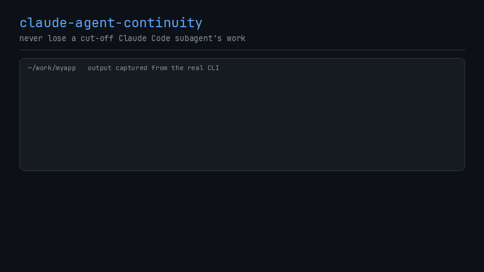

# claude-agent-continuity

[](https://github.com/Caelos-Palacio/claude-agent-continuity/actions/workflows/ci.yml)

Never lose a cut-off Claude Code subagent's work: safe WIP commits per git worktree, status, and ready-to-send resume prompts. Zero dependencies, Node >= 18.



<sub>Output in the demo is captured from the real CLI. Regenerate with `python3 docs/media/demo.py capture && python3 docs/media/demo.py` (needs Pillow and ffmpeg; not part of the npm package).</sub>

## Why
Claude Code subagents often run in their own git worktrees. When one is cut off (usage limit, watchdog timeout, kill), whatever it had not yet committed sits dirty in the worktree, easy to overlook or clobber, and the next agent has no pointer to where it left off.

## Features

- `wip`: commits pending changes in every linked worktree as a WIP commit, safely.
- `status` (the default command): lists worktrees that still hold unintegrated work (`*` dirty, `o` clean, `!` skipped as busy) with branch, commits ahead of the base branch, dirty file count and handoff docs; merged-and-clean worktrees are only counted.
- `resume [name]`: prints a ready-to-send prompt per unfinished worktree telling the agent to read its handoff doc (or `git log <base>..HEAD` if there is none), then continue.
- `install-hook`: wires `wip` into Claude Code's `SubagentStop` and `Stop` hooks.

## Quick start

```sh
git clone https://github.com/Caelos-Palacio/claude-agent-continuity
cd claude-agent-continuity
node bin/claude-agent-continuity.mjs install-hook --global    # or --project, or no flag to just print the block
```

`install-hook` reads your existing `settings.json`, preserves everything in it, writes a timestamped `.bak-*` backup, and is idempotent. It refuses to touch a file that is not valid JSON. The hook command points at this checkout's absolute path and is guarded (`[ -f "$f" ] && node "$f" wip --quiet || true`), so it is harmless if you later move or delete the clone. You can also `npm link` / `npm i -g .` and use `claude-agent-continuity` directly (pass `--command` to `install-hook` to use that name).

## Usage

```sh
claude-agent-continuity status [--json]
claude-agent-continuity wip [--quiet] [--json]
claude-agent-continuity resume [name] [--json]
claude-agent-continuity install-hook [--global|--project] [--settings <file>] [--command <cmd>]
```

| Option | Meaning |
|---|---|
| `--repo <dir>` | Repo to operate on (default: current directory; any worktree of the repo works) |
| `--base <branch>` | Base branch for "ahead"/"merged" (default: `origin/HEAD`, else `main`, `master`, else the main worktree's branch) |
| `--handoff <glob>` | Handoff doc pattern, repeatable (default: `docs/handoff/**/*.md`, `docs/HANDOFF.md`, `HANDOFF.md`). Only handoffs changed on the branch or in the working tree are reported |
| `--message <tpl>` | WIP commit message; placeholders `{branch}` `{name}` `{count}` |
| `--json` | Machine-readable output |
| `--quiet` / `--hook` | Hook mode: prints a `systemMessage` JSON only when something was saved, and always exits 0 (errors and unknown commands included) |
| `--include-main` | Also treat the main worktree as a target (off by default) |

Exit codes (outside hook mode): `0` success, `1` error (e.g. not a git repository), `2` unknown command.

## How it works

Worktrees come from `git worktree list --porcelain` (not just `.claude/worktrees`); the main worktree is excluded. For each dirty worktree, `wip` runs `git add -A`, unstages `node_modules` and newly added symlinks, and commits with `--no-verify` and no signing. If no git identity is configured it uses a placeholder one for that commit only. Git is always called through `execFileSync` with an argv array, never through a shell.

A worktree is skipped (and left byte-for-byte untouched) when it has a merge, rebase, cherry-pick, revert or bisect in progress, unresolved conflicts, a `index.lock`, or a detached HEAD.

## Limitations

- It saves files, not agent context: the resume prompt is only as good as the handoff doc the agent kept.
- WIP commits are plain commits on the agent's branch; squash or reword before merging.
- Detached-HEAD worktrees are skipped, not saved.
- A hook only fires when Claude Code gets to run it; a hard kill of the whole process may skip it. Run `wip` manually afterwards, the work is still on disk.
- Untracked files not matched by `.gitignore` (other than `node_modules` and new symlinks) are committed, including anything sensitive left in the worktree. Keep secrets in `.gitignore`.
- The hook runs on every subagent stop and can race with an agent still writing; it is best-effort.

## Resumen en español (summary in Spanish)

Cuando un subagente de Claude Code se corta (límite de uso, watchdog, kill), el trabajo sin commitear se pierde o queda olvidado en su worktree. Esta herramienta hace commits WIP seguros en cada worktree (nunca toca uno en merge/rebase, con conflictos o con `index.lock`; ignora `node_modules` y symlinks nuevos), muestra el estado (`status`), genera el mensaje para reanudar leyendo el handoff (`resume`) e instala el hook `SubagentStop`/`Stop` (`install-hook --global|--project`). Sin dependencias, Node >= 18. Limitaciones: guarda archivos, no el contexto del agente; los commits WIP conviene aplastarlos antes de integrar.

## Tests

`npm test` (node:test, temporary git repos). CI runs it on Node 18, 20 and 22.

## License

MIT
